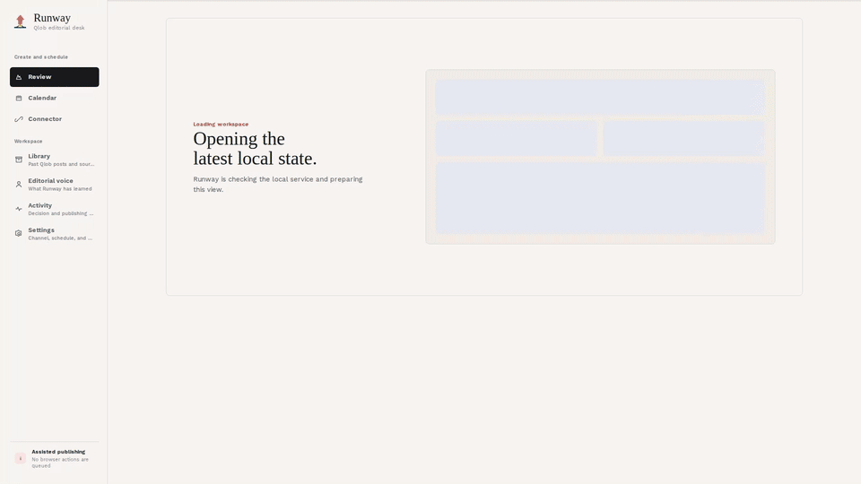

# Runway

[](https://github.com/ChardXBT/Runway/actions/workflows/ci.yml)

Runway is a local editorial tool for planning image posts on a YouTube channel's Community tab.
It learns from the channel's past posts, finds candidate images, drafts captions that are checked
against what is actually in the picture, and lets the creator accept, edit, or reject each option.
Accepted posts go into a Lineup calendar with at most one Runway post per day.

It was built for one channel (Qlob) and runs entirely on the creator's own machine: a FastAPI
backend and a Next.js frontend, both bound to `127.0.0.1`. The creator stays in control. Nothing
is published unless they explicitly ask for it from the Lineup.

## Demo

[](docs/media/runway/runway-demo.mp4)

A 36-second silent walkthrough of the real app: the review desk presents one post
option (image plus grounded captions), the creator accepts it, and the post lands
in the Lineup release calendar for the next day at 10:00 AM. Watch the full video
([MP4, 1.6 MB](docs/media/runway/runway-demo.mp4)) or see the
[poster frame](docs/media/runway/runway-poster.png).

## What works today

- **History capture.** A headed, read-only browser capture of the channel's Community posts into
  SQLite. It is resumable and verifies its own completeness.
- **Channel intelligence.** Versioned annotations of past posts, image and text representations,
  persisted retrieval evidence, and a channel profile split into content modes.
- **Image discovery.** Candidates from public screenshot archives (Frinkiac, Morbotron, the Family
  Guy wiki), DuckDuckGo, an optional browser image search, a configured search API, or manual
  URLs. Each image is downloaded through a bounded, SSRF-resistant fetcher, then filtered for
  duplicates, unsafe sources, quality, and recent repetition.
- **Grounded captions.** Captions are drafted by the Codex CLI (signed in with ChatGPT, no API-key
  billing) from retrieved channel evidence. A blind visual audit and a separate grounding check
  must agree with every factual premise; if nothing passes, Runway shows nothing rather than
  guessing.
- **Review desk.** One option at a time with Reject, Edit, and Accept. Every decision is stored as
  append-only feedback that shapes later retrieval and ranking.
- **Lineup.** Calendar and list views, timezone-aware date and time editing, swaps, and removal.
  Posts that YouTube may already have received are locked against edits.
- **Assisted publishing (default).** Runway validates the post and prepares the image, caption,
  and timing; the creator schedules it natively in YouTube.

## Experimental or not yet proven

- **Authorized browser publishing.** A serialized outbox drives a visible Chrome session to
  schedule posts. It is off unless three separate settings are enabled and the Lineup action is
  confirmed. It has not yet passed a supervised acceptance on the live channel.
- **Trained preference models.** Dataset, training, shadow-evaluation, and activation tooling
  exists, but no trained model is active yet. Ranking currently uses deterministic features,
  retrieval, and recorded preferences.
- **Neural embeddings.** Sentence-Transformers and SigLIP 2 adapters are optional extras. Their
  weights are not installed or activated by default.
- **Image generation.** Only a deterministic mock provider exists behind the provider boundary.

YouTube's Data API has no Community-post endpoint, so API-based publishing is not possible. See
[docs/CURRENT_LIMITATIONS.md](docs/CURRENT_LIMITATIONS.md) for the full list.

## Architecture

```text
Browser
  -> Next.js app (127.0.0.1:3000)
  -> FastAPI (127.0.0.1:8000)
  -> service layer
       |- SQLite (WAL, Alembic migrations)
       |- Codex CLI subprocess (read-only sandbox, one call at a time)
       |- search providers and the bounded image downloader
       `- Playwright browsers (history capture, optional publisher)
```

Next.js renders pages from API data, and actions in the browser call the API directly. The CLI
and the API share the same services. SQLite is the system of record for posts, media,
annotations, retrieval evidence, feedback, proposals, and audit events. Model output is
schema-validated and treated as data. More detail is in
[docs/ARCHITECTURE.md](docs/ARCHITECTURE.md) and [docs/INTELLIGENCE.md](docs/INTELLIGENCE.md).

| Layer | Technology |
| --- | --- |
| Backend | Python 3.13, FastAPI, Pydantic 2, SQLAlchemy 2, Alembic, SQLite, Typer, httpx, Pillow, NumPy |
| Frontend | Next.js 16, React 19, TypeScript, Tailwind CSS 4 |
| Models | OpenAI Codex CLI (version pinned in `package.json`); a mock runtime for tests and demos |
| Browser | Playwright: bundled Chromium for capture, installed Google Chrome for the publisher |
| Tests and CI | pytest, mypy (strict), Ruff, Vitest, Testing Library, ESLint, GitHub Actions on Ubuntu and Windows |

## Prerequisites

- Windows 10 or 11 for the production launcher and scheduled task. The backend and tests also run
  on Linux and macOS.
- Python 3.13
- Node.js 20 or newer (CI uses Node 24)
- Google Chrome, only for the YouTube publisher
- A ChatGPT account signed in to Codex, only for real caption generation. Tests and the demo
  use the mock runtime.

## Installation

```powershell
git clone https://github.com/ChardXBT/Runway.git
cd Runway
py -3.13 -m venv .venv
.\.venv\Scripts\python.exe -m pip install -r requirements.lock
.\.venv\Scripts\python.exe -m pip install --no-deps -e .
npm ci
Copy-Item .env.example .env
.\.venv\Scripts\runway.exe init
.\.venv\Scripts\runway.exe doctor
```

`npm ci` at the root installs the pinned Codex CLI and then the web app's dependencies.
`requirements.lock` pins the full environment, including the development tools. History capture
also needs Playwright's browser: `.\.venv\Scripts\python.exe -m playwright install chromium`.

## Try it without accounts or network

```powershell
.\.venv\Scripts\python.exe scripts\e2e_demo.py
```

This runs capture, analysis, profiling, discovery, caption generation, review decisions, and
scheduling against bundled fixtures with the mock runtime, in a fresh `data/proofs/<timestamp>`
directory, and prints a JSON report.

## Running locally

Production stack on Windows (built frontend, both services, health-checked):

```powershell
npm run web:build
powershell -NoProfile -ExecutionPolicy Bypass -File .\run-runway.ps1
```

Then open <http://127.0.0.1:3000/review>. The launcher never kills a process it did not start,
refuses to share a port with an unrelated program, and only reports success once both services
answer their health checks. To start Runway at logon and restart a crashed component, install the
scheduled task:

```powershell
powershell -NoProfile -ExecutionPolicy Bypass -File .\scripts\install_windows_task.ps1
```

For development, run `.\.venv\Scripts\runway.exe serve` and `npm run web:dev` in two terminals,
or `./run-runway.sh` on macOS or Linux.

Real caption generation needs Codex signed in with ChatGPT:

```powershell
.\.venv\Scripts\runway.exe agent login
.\.venv\Scripts\runway.exe agent status
```

History capture, the daily workflow, publisher setup, backups, and troubleshooting are covered in
[docs/OPERATIONS.md](docs/OPERATIONS.md).

## Tests and checks

```powershell
.\.venv\Scripts\python.exe -m ruff check .
.\.venv\Scripts\python.exe -m ruff format --check .
.\.venv\Scripts\python.exe -m mypy src/runway
.\.venv\Scripts\python.exe -m pytest
.\.venv\Scripts\python.exe -m pip_audit
npm run check
npm --prefix apps/web audit --omit=dev
node scripts/audit_web_dependencies.mjs
```

`npm run check` runs ESLint, the TypeScript compiler, Vitest, and a production build. The test
suite forces the mock runtime and disables publishing, so it never uses model allowance or
contacts YouTube. CI runs all of the above, plus the PowerShell launcher contracts on Windows.

## Security

- Both servers bind to loopback and only answer loopback `Host` headers, which blocks DNS
  rebinding. The API also refuses state-changing requests from other origins.
- Third-party image downloads accept only public addresses, revalidate every redirect, and are
  limited in bytes, time, and decoded pixels.
- Codex subprocesses run without API-key credentials, in a read-only sandbox, one at a time.
- `.env`, databases, media, and browser profiles are ignored by Git.

One development-only npm advisory (`braces`, no patched release) is accepted under a documented,
expiring exception. Production dependencies have no known advisories. Details are in
[docs/SECURITY.md](docs/SECURITY.md).

## Repository layout

```text
src/runway/      Python package: API, CLI, services, database models, providers
apps/web/        Next.js frontend
alembic/         Database migrations
tests/           Unit, integration, and end-to-end tests
docs/            Architecture, operations, security, and intelligence documentation
benchmarks/      Frozen intelligence evaluation datasets and results
scripts/         Windows task installer, fixture demo, audit and maintenance scripts
```

## License

Copyright (c) 2026 Eric Song. All rights reserved. The source is public so it can be viewed as a
portfolio project. It is not open source, and no license to use, copy, modify, or distribute it
is granted. See [LICENSE](LICENSE).
