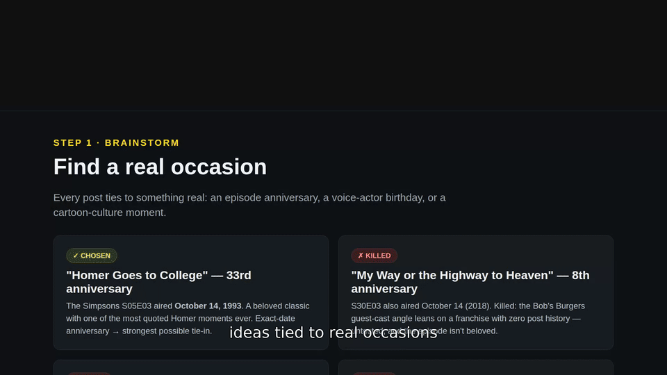
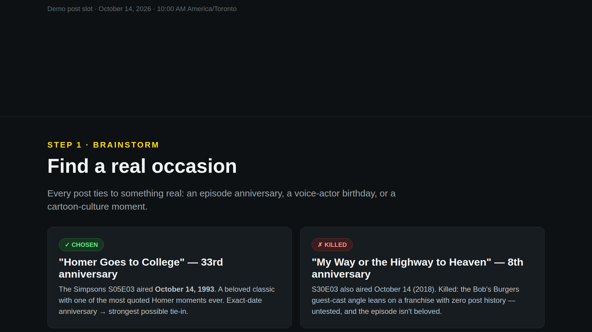
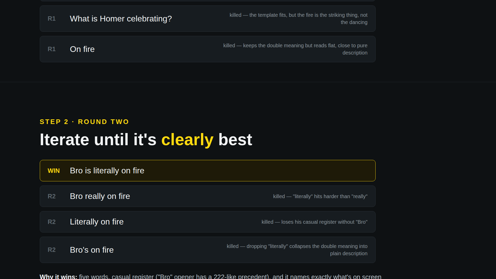
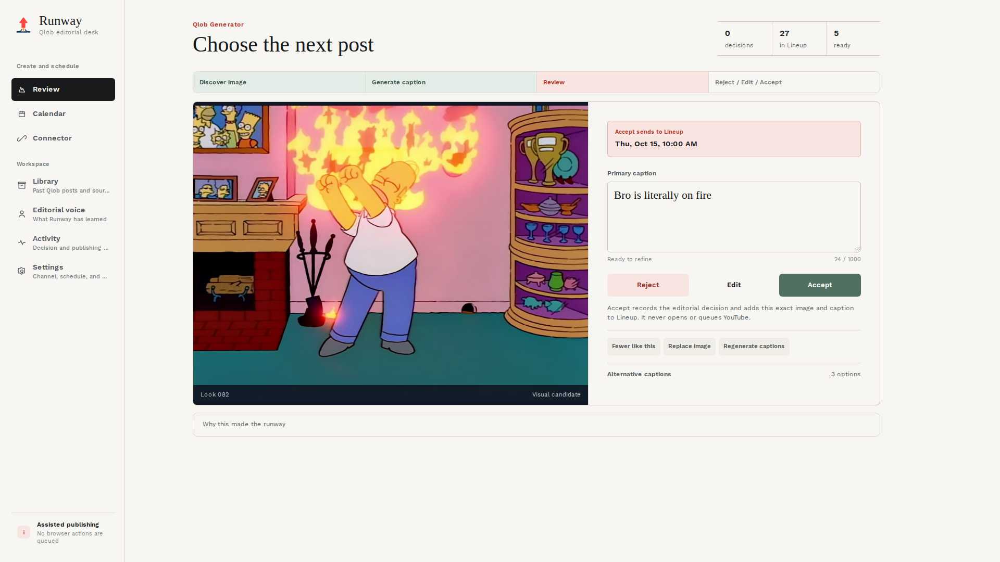
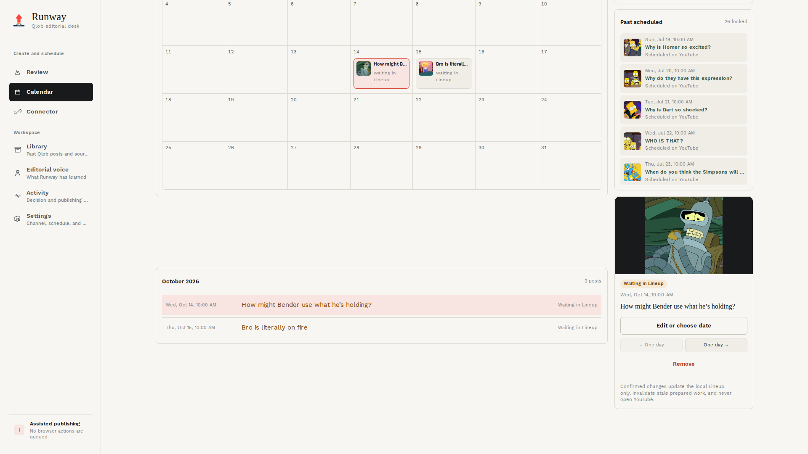
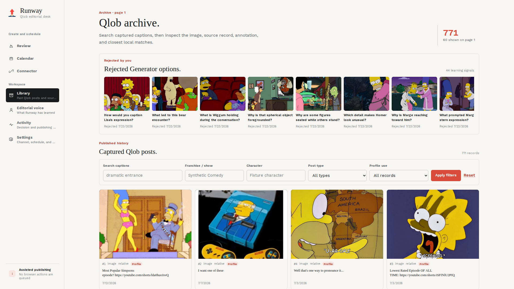
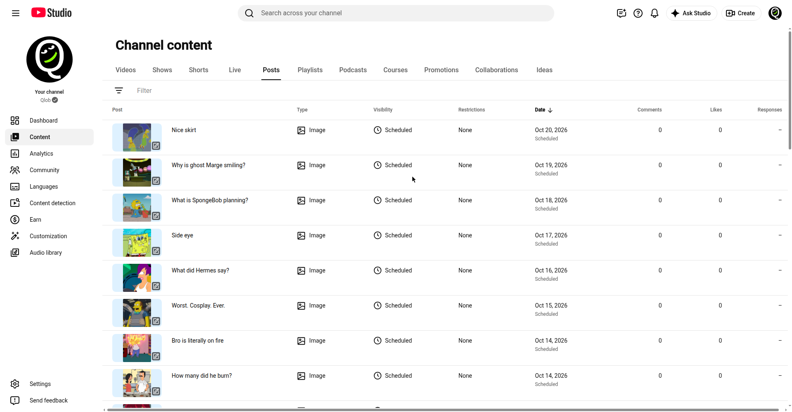

# Runway

[](https://github.com/ChardXBT/Runway/actions/workflows/ci.yml)

Runway is a local editorial desk for planning image posts on a YouTube channel's Community tab.
Posting every day keeps a channel alive, but doing it by hand every morning is a grind, and the
quality drifts. Runway studies the channel's own history, finds candidate images, drafts captions
that are checked against what is actually in the picture, and presents one option at a time for a
human to accept, edit, or reject. Accepted posts go into a Lineup calendar, at most one Runway
post per day.

It was built for one channel (Qlob) and runs entirely on the creator's own machine: a FastAPI
backend and a Next.js frontend, both bound to `127.0.0.1`. There is no cloud account, no data
leaving the machine, and nothing is published unless the creator explicitly asks for it.

## Demo

[](docs/media/runway/runway-demo.mp4)

A 36-second silent walkthrough of the real app: the review desk presents one post option (image
plus grounded captions), the creator accepts it, and the post lands in the Lineup release
calendar for the next day at 10:00 AM. Watch the full video
([MP4, 1.6 MB](docs/media/runway/runway-demo.mp4)) or see the
[poster frame](docs/media/runway/runway-poster.png).

## Runway x Muse integration workflow

[](docs/media/runway/runway-workflow.mp4)

A 52-second silent documentary of one real post, start to finish. Muse, the channel's AI manager
built on this Runway integration, brainstorms ideas tied to a real occasion, designs the image,
runs a caption tournament, and loads the winner onto Runway's review desk. The creator accepts it
with one click, it lands in the Lineup calendar, and the same post goes out on YouTube the next
morning at 10:00 AM. Watch the full video
([MP4, 4.6 MB](docs/media/runway/runway-workflow.mp4)) or see the
[poster frame](docs/media/runway/workflow-poster.png).

### How a post gets made

1. **Brainstorm.** Every post ties to something real: an episode anniversary, a voice-actor
   birthday, or a cartoon-culture moment. The demo post: the 33rd anniversary of "Homer Goes to
   College" (S05E03, aired October 14, 1993).
2. **Design.** A real episode still is picked for one readable moment. Here: Homer mid
   victory-dance, engulfed in flames.
3. **Caption tournament.** Six candidates in round one, four in round two, judged in the
   channel's own voice (short, casual, no hashtags). Winner: "Bro is literally on fire".
4. **Review.** Runway's desk presents the image, the grounded caption options, and the
   rationale. The creator accepts, edits, or rejects, one option at a time. Nothing ever goes to
   YouTube from this desk.
5. **Lineup and publish.** The accepted post lands on the release calendar (at most one Runway
   post per day) and publishes to YouTube at 10:00 AM.

The demo post ("Bro is literally on fire") was really scheduled on the Qlob channel for
October 14, 2026 at 10:00 AM America/Toronto.

### Screenshots








## Features

### Learns the channel's voice

Runway starts by capturing the channel's Community post history into SQLite with a headed,
read-only browser capture that is resumable and verifies its own completeness. It annotates past
posts (versioned), builds image and text representations, and keeps retrieval evidence behind
every claim it makes later. The result is a channel profile, split into content modes, that the
rest of the pipeline actually cites instead of guessing from vibes.

### Finds images worth posting

Candidates come from public screenshot archives (Frinkiac, Morbotron, the Family Guy wiki),
DuckDuckGo, an optional browser image search, a configured search API, or manual URLs. Every
image goes through a bounded, SSRF-resistant downloader, then gets filtered for duplicates
(perceptual hashing plus embedding similarity), unsafe sources, quality, and recent repetition.
Only stills that read clearly at a glance survive.

### Writes captions that match the picture

Captions are drafted by the Codex CLI (signed in with ChatGPT, so there is no API-key billing)
from retrieved channel evidence. Generation produces a nine-item pool: four open questions, three
observations, two reactions. A blind visual audit and a separate grounding check must agree with
every factual premise in the caption. If nothing passes, Runway shows nothing rather than
guessing. A deterministic reranker then favors open-ended questions, style fit, and novelty,
while penalizing engagement bait, flat descriptions, and repeats of past posts.

### One decision at a time

The review desk shows a single option: the image, the grounded caption alternatives, and the
rationale. Reject, Edit, or Accept. Every decision is stored as append-only feedback that
immediately shapes later retrieval and ranking, so the system gets sharper the more it is used.
No retraining required.

### A calendar, not a queue

Accepted posts land in the Lineup, with calendar and list views, timezone-aware date and time
editing, swaps, and removal. Posts that YouTube has already received are locked against edits.
The one-post-per-day rule is a product policy, not a platform limit.

### Publishing stays in human hands

YouTube's Data API has no Community-post endpoint, so API publishing is not possible. By default,
Runway validates the post and prepares exact native posting instructions, and the creator
schedules it in YouTube directly. An authorized browser-publishing mode exists behind three
separate opt-in settings plus a confirmed Lineup action, driving a visible Chrome session
through a serialized outbox, one post at a time. It has not yet passed supervised acceptance on
the live channel. Runway will not add stealth automation, CAPTCHA bypass, or automatic
challenge handling.

### Supporting surfaces

- **Archive / Library.** The full captured history plus every rejected generator option,
  searchable and filterable. Rejections are learning signals, not trash.
- **Connector.** Verifies the channel, the active identity, and posting capability with a real
  browser check, and reports last-known status honestly. It never claims more than the check
  proved.
- **Editorial voice / Profile.** Caption, image, and pairing signals, human pairwise labels,
  preference datasets, and blind-study progress. This is where a trained preference model will
  be activated in the future, only after its quality gates pass.
- **Activity.** A complete log of decisions and publishing events.
- **Queue.** The serialized outbox behind authorized browser publishing.
- **Settings.** Channel, schedule, and provider configuration.

## Roadmap

Planned, not implemented. The conservative full list lives in
[docs/CURRENT_LIMITATIONS.md](docs/CURRENT_LIMITATIONS.md), which separates unfinished work
from external blockers on purpose.

- **Learned preference ranking.** Collect genuine accept, edit, and reject events to train a
  lightweight reranker. The gate is 100 clean comparisons per target plus a sealed blind
  evaluation. Synthetic data never counts as creator ground truth.
- **Blind creator study.** A 50-case blind study measuring caption quality the way the creator
  actually judges it.
- **Neural image representations.** Evaluate a trusted local neural image model against the
  deterministic baseline, and activate it only if it wins without reducing grounding or
  diversity.
- **Supervised publishing acceptance.** Complete one supervised live publishing run in
  authorized browser mode.
- **Audience performance.** Import impressions, likes, and comments, normalized for post age
  and exposure, as a signal kept separate from creator preference. Blocked on a documented,
  permitted data source.
- **Richer tooling.** UI for experiments, blind studies, and model activation; richer archive
  filters.
- **Beyond single-user.** Runway is local and single-user by design today. A hosted version
  would need real signup, workspaces, tenant-isolated data, and per-customer publisher
  identities. That is future work, not a flag flip.

## Architecture

```text
Browser
  -> Next.js app (127.0.0.1:3000)
  -> FastAPI (127.0.0.1:8000)
  -> service layer
       |- SQLite (WAL, Alembic migrations)
       |- Codex CLI subprocess (read-only sandbox, one call at a time)
       |- search providers and the bounded image downloader
       `- Playwright browsers (history capture, optional publisher)
```

Next.js renders pages from API data, and actions in the browser call the API directly. The CLI
and the API share the same services. SQLite is the system of record for posts, media,
annotations, retrieval evidence, feedback, proposals, and audit events. Model output is
schema-validated and treated as data, never trusted blindly. More detail is in
[docs/ARCHITECTURE.md](docs/ARCHITECTURE.md) and [docs/INTELLIGENCE.md](docs/INTELLIGENCE.md).

| Layer | Technology |
| --- | --- |
| Backend | Python 3.13, FastAPI, Pydantic 2, SQLAlchemy 2, Alembic, SQLite, Typer, httpx, Pillow, NumPy |
| Frontend | Next.js 16, React 19, TypeScript, Tailwind CSS 4 |
| Models | OpenAI Codex CLI (version pinned in `package.json`); a mock runtime for tests and demos |
| Browser | Playwright: bundled Chromium for capture, installed Google Chrome for the publisher |
| Tests and CI | pytest, mypy (strict), Ruff, Vitest, Testing Library, ESLint, GitHub Actions on Ubuntu and Windows |

## Prerequisites

- Windows 10 or 11 for the production launcher and scheduled task. The backend and tests also run
  on Linux and macOS.
- Python 3.13
- Node.js 20 or newer (CI uses Node 24)
- Google Chrome, only for the YouTube publisher
- A ChatGPT account signed in to Codex, only for real caption generation. Tests and the demo
  use the mock runtime.

## Installation

```powershell
git clone https://github.com/ChardXBT/Runway.git
cd Runway
py -3.13 -m venv .venv
.\.venv\Scripts\python.exe -m pip install -r requirements.lock
.\.venv\Scripts\python.exe -m pip install --no-deps -e .
npm ci
Copy-Item .env.example .env
.\.venv\Scripts\runway.exe init
.\.venv\Scripts\runway.exe doctor
```

`npm ci` at the root installs the pinned Codex CLI and then the web app's dependencies.
`requirements.lock` pins the full environment, including the development tools. History capture
also needs Playwright's browser: `.\.venv\Scripts\python.exe -m playwright install chromium`.

## Try it without accounts or network

```powershell
.\.venv\Scripts\python.exe scripts\e2e_demo.py
```

This runs capture, analysis, profiling, discovery, caption generation, review decisions, and
scheduling against bundled fixtures with the mock runtime, in a fresh `data/proofs/<timestamp>`
directory, and prints a JSON report.

## Running locally

Production stack on Windows (built frontend, both services, health-checked):

```powershell
npm run web:build
powershell -NoProfile -ExecutionPolicy Bypass -File .\run-runway.ps1
```

Then open <http://127.0.0.1:3000/review>. The launcher never kills a process it did not start,
refuses to share a port with an unrelated program, and only reports success once both services
answer their health checks. To start Runway at logon and restart a crashed component, install the
scheduled task:

```powershell
powershell -NoProfile -ExecutionPolicy Bypass -File .\scripts\install_windows_task.ps1
```

For development, run `.\.venv\Scripts\runway.exe serve` and `npm run web:dev` in two terminals,
or `./run-runway.sh` on macOS or Linux.

Real caption generation needs Codex signed in with ChatGPT:

```powershell
.\.venv\Scripts\runway.exe agent login
.\.venv\Scripts\runway.exe agent status
```

History capture, the daily workflow, publisher setup, backups, and troubleshooting are covered in
[docs/OPERATIONS.md](docs/OPERATIONS.md).

## Tests and checks

```powershell
.\.venv\Scripts\python.exe -m ruff check .
.\.venv\Scripts\python.exe -m ruff format --check .
.\.venv\Scripts\python.exe -m mypy src/runway
.\.venv\Scripts\python.exe -m pytest
.\.venv\Scripts\python.exe -m pip_audit
npm run check
npm --prefix apps/web audit --omit=dev
node scripts/audit_web_dependencies.mjs
```

`npm run check` runs ESLint, the TypeScript compiler, Vitest, and a production build. The test
suite forces the mock runtime and disables publishing, so it never uses model allowance or
contacts YouTube. CI runs all of the above, plus the PowerShell launcher contracts on Windows.

## Security

- Both servers bind to loopback and only answer loopback `Host` headers, which blocks DNS
  rebinding. The API also refuses state-changing requests from other origins.
- Third-party image downloads accept only public addresses, revalidate every redirect, and are
  limited in bytes, time, and decoded pixels.
- Codex subprocesses run without API-key credentials, in a read-only sandbox, one at a time.
- `.env`, databases, media, and browser profiles are ignored by Git.

One development-only npm advisory (`braces`, no patched release) is accepted under a documented,
expiring exception. Production dependencies have no known advisories. Details are in
[docs/SECURITY.md](docs/SECURITY.md).

## Repository layout

```text
src/runway/      Python package: API, CLI, services, database models, providers
apps/web/        Next.js frontend
alembic/         Database migrations
tests/           Unit, integration, and end-to-end tests
docs/            Architecture, operations, security, and intelligence documentation
benchmarks/      Frozen intelligence evaluation datasets and results
scripts/         Windows task installer, fixture demo, audit and maintenance scripts
```

## License

Copyright (c) 2026 Eric Song. All rights reserved. The source is public so it can be viewed as a
portfolio project. It is not open source, and no license to use, copy, modify, or distribute it
is granted. See [LICENSE](LICENSE).
