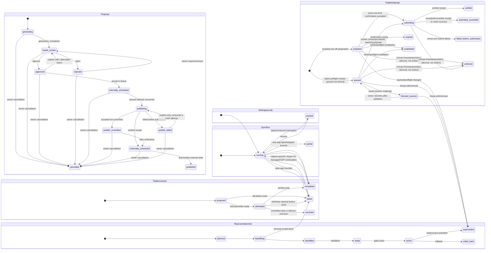

# State-machine review: Runway transitions and recovery

Date: 2026-11-27  
Audited base: `9cae17a443ec4126a3f2d877e7dfc1b59e1254cd` (`main` / `origin/main`)  
Mode: source audit plus disposable fixture databases only. No credentials, live accounts, browser publishing, deployments, destructive actions, or external writes were used.

## Scope and overlap

This review covers workspace jobs, OAuth boundaries, publishing, migration, reviewer exports, drafts/inbox actions, and scheduled work. It intentionally does not repeat the whole root `IMPLICIT-STATE-MACHINES.md` audit. Overlap checked: merged PR #3 (`Audit: implicit state machines`) is the broad earlier audit; issue #15 / PR #16 covered integrated publishing controls and migration rehearsal; issue #22 covered offline reviewer export/time-zone verification. Those areas are cited here rather than re-audited wholesale. The earlier broad audit is partly stale: the old highest-risk `PublishAttempt` machine now has an explicit declared transition table, fail-closed `unknown` handling, restart recovery, and an extensive fixture suite. This report therefore narrows to the current controls and the gaps/uncertainties that remain at base `9cae17a`.

Evidence basis:

- static reads of the code paths listed below;
- existing fixture-backed suites named in this report;
- three additional disposable-database probes executed during this audit, quoted in the findings;
- no live OAuth, social-account, browser, paid-provider, or deployment execution.

## Main transition graph



## State table

| Machine / persisted rows | States and signals | Triggers and side effects | Recovery / concurrency control | Assessment |
| --- | --- | --- | --- | --- |
| `Proposal` | Declared enum: `generating`, `needs_review`, `approved`, `rejected`, `internally_scheduled`, `publishing`, `externally_scheduled`, `publish_unverified`, `published`, `publish_failed`, `cancelled`; also timestamps and scores. | Generation creates `generating` then immediately `needs_review`; owner approval/editing/scheduling transitions; publish receipt/failure transitions external states. | Declared transition table in `src/runway/domain/state_machine.py`; core accept/reject is transactional. Schedule slot selection is protected only by a process-local lock and application-level scan. | Core machine is explicit. Cross-process double-booking remains a missing control because `scheduled_publish_at` is indexed but not unique/leased. |
| `PublishAttempt` | Declared enum: `prepared`, `queued`, `submitting`, `blocked_session`, `verified`, `submitted_unverified`, `failed_before_submission`, `expired`, `invalidated`, `superseded`, `unknown`; payload hash, confirmation hash, submitted/completed timestamps, receipt fields. | Explicit owner confirmation and batch preflight; worker consumes queued rows; browser write; verified/unverified/failure receipt. | Declared transition validation, timestamp consistency, `unknown` fail-closed behavior, interruption recovery to `submitted_unverified`, late outcomes preserved as audit evidence. Queue worker uses process-local locks; claim is read/check/write rather than one conditional DB update/lease. | Much stronger than the earlier audit. Residual high-risk gap is cross-process duplicate dispatch/timeout misclassification, not intra-process ordering. |
| Publisher queue coordinator | In-memory worker absent/present, paused reason, ready state; persisted attempts supply durable state. | Startup/resume starts worker when saved session is valid and queued rows exist; exceptions pause worker. | Restart reads persisted queue and reruns recovery. In-process mutex prevents duplicate local workers. No cross-process worker ownership exists. | Restart behavior is fixture-covered. Cross-process ownership is not. |
| Capture/search/generation/image-generation runs | Raw status strings: `running`, `paused`, `completed`, `failed`; timestamps, counters, cursors, error summaries. | CLI/UI/API jobs create rows; providers/fixtures process candidates; finalizer marks terminal state. | Capture resume can reopen prior runs, including `completed` for managed/CDP continuation. Stale search/generation recovery is age-based (6h or size-adjusted) and only runs when a new job starts. No heartbeat, cancellation row, lease, or run transition guard. | Partial success is represented inconsistently: proposal batches return `partial` but store `failed`; discovery returns `completed_with_errors` but stores `completed`. Crash-stuck rows can be overwritten by the original late worker. |
| Legacy/generic `ModelRun` audit rows | `completed` or `failed`, with start/completion timestamps, token usage, cost, prompt version, request/output summaries. | Model-call wrappers persist a terminal audit row after the call returns or fails. | Rows are normally written only in terminal form, so they do not create a stale `running` recovery problem. They are evidence records rather than executable jobs. | Adequate as audit evidence; not a recovery machine. Cost/token fields are usage evidence, not a money-movement control. |
| Intelligence agent runs/steps | Parent run statuses include `running`, `completed`, `failed`, `abstained`; step rows have sequence/attempt/status/usage/artifacts; deterministic `run_key` unique. | Handlers execute capability-scoped steps with timeouts and retries; terminal rows persist usage and artifacts. | Idempotent reuse only for `completed`/`abstained`; any other existing status rejects same-key execution. No stale `running` recovery. | Proven fixture gap: a failed deterministic run key cannot be retried. Concurrent same-key creation likely relies on the unique constraint and may surface an integrity error rather than a clean claim. |
| Representation sets/items and activation | Set: `planned`, `backfilling`, `backfilled`, `ready`, `active`, `superseded`, `rolled_back`, `failed`; item: `pending`, `running`, `complete`, `failed`, `stale`; counts and activation rows mirror progress. | Backfill embeds sources; validation recomputes counts; activation supersedes old active set and writes an activation event atomically; rollback flips active/rolled-back atomically. | Activation/rollback gates are strong. Backfill selects only `pending`/`failed`; an item committed as `running` before a crash is not selected again. | Proven fixture gap: `running` orphan remains unselected. Clock/crash assumptions are not encoded as leases/heartbeats. |
| Annotation/preference activation families | Annotation refresh runs: `planned`, `running`, `backfilled`, `ready`, `active`, `superseded`, `failed`; items `pending/running/complete/failed/stale`. Preference datasets are `frozen`; model versions include `trained`, `active`, `superseded`, `rolled_back`, `insufficient_data`. | Annotation batches run analysis and refresh item states; preference training creates immutable artifact-hashed versions; activation/rollback writes activation events. | Activation/rollback rows are transactional and reject multiple active rows. Annotation validation can turn a `running` item without an annotation into `failed`, unlike representation backfill. | Controls are stronger than the oldest implicit-status design, but this audit did not exercise real model activation or paid/model calls. |
| OAuth state / connected account / token store | OAuth state rows have unique `state`, expiry, and `consumed_at`; accounts have `status`, scopes, token ref, sync mirrors; token blob is encrypted JSON. | Connect issues state; callback consumes state, exchanges code, writes account row, stores token; disconnect revokes/deletes token and disconnects row. | OAuth consume is a single conditional `UPDATE` and fixture-tested as single-use under concurrency. Token writes use a cross-process file lock plus atomic `os.replace`. Account row commits before token blob write, so a crash between those operations can leave `connected` without token bytes. | OAuth state machine is strong. Durable account/token atomicity is a residual crash-recovery gap. |
| `SyncRun`, `SyncCursor`, scheduler | Run `running/completed/partial/failed`, step JSON, item/quota/error counts; cursors `complete` or `resume`; account mirror fields. | Manual or interval scheduler starts sync; steps store content/comments/metrics and cursor progress; exceptions produce terminal run state and account status. | Process-local per-account lock plus a database scan for recent `running` rows; stale rows older than 30 minutes are marked failed at startup. No DB lease/conditional claim. | In-process duplicate sync prevention and stale startup recovery are fixture-tested. Cross-process duplicate manual sync remains unproven but unguarded. Scheduler first tick is interval-delayed and `stop()` leaves no clear restart semantics. |
| `PlatformAction` / comment reply | `proposed`, `attempted`, `completed`, `failed`, `uncertain`; attempt/completion/verified timestamps, external result id, error, redacted request/response. | Owner-triggered reply creates action, refreshes token, sends non-idempotent public write, records verified/unverified outcome. | Timeout-after-send and rejection tests exist. `uncertain` is deliberately non-retryable. | Proven fixture gap: when provider returns `verified=False`, action is `uncertain` but the comment is still marked `answered` and `has_owner_reply=true`. This can hide a write needing manual verification. |
| `ContentDraft` / `DraftTarget` | Draft status observed as `draft`, `scheduled`, `archived`, `published`, or `partially_published`; the API only permits `draft`/`scheduled` edits. Target status observed as `pending` or `published`, with timestamps/external URL linkage. | Draft creation/editing schedules targets; owner can mark a target published with an http(s) URL; parent status is recomputed only when a target is marked published. | Status is partly derived from child targets rather than one declared transition table. Duplicate targets for the same platform/account are rejected. | Low external-write risk because these are local records, but parent status recomputation is one-way: once `published`/`partially_published`, later edits or target changes do not recalculate it. |
| Blind study / reviewer export | Blind study: `planned`, `exported`, `in_progress`, `completed`; frontier arena: `planned`, `in_review`, `completed`; cases carry hidden provenance and responses are immutable by duplicate rejection. | Export writes a local JSON packet after minimum-case/provenance checks (or arena provenance checks); import validates cases, duplicates, reviewer kind, and creates preferences in the same transaction. | Blind export scans serialized payload and nested metadata for hidden identities/keys; escaped/nonfinite metadata tests exist. Arena export scans the encoded packet for hidden arm labels. Engineering fixture labels require mock runtime and publishing disabled. | Strong provenance controls. Residual semantics: export file write and study status update are not atomic; repeated export has no distinct idempotency state, and no export artifact hash is persisted in the study row. |
| Alembic migration / schema contract | `alembic_version` is the schema state; migrations are ordered `0001` through `0012_creator_platforms`; schema fingerprint/catalog records tables/indexes/constraints. | App startup always runs `upgrade(..., "head")`; doctor compares current migration/fingerprint with canonical snapshots. | Migration tests cover upgrade, downgrade, row preservation, and canonical schema. Alembic logs SQLite as non-transactional DDL; there is no migration lease or application stop gate around startup migrations. | Versioned migration state is explicit. Concurrent startup or crash mid-migration recovery remains a deployment/operator uncertainty rather than a tested fixture gap. |
| Windows launcher / scheduled watchdog | Launcher file lock, service readiness, port ownership, child process state, log rotation; scheduled task trigger/repetition/restart settings. | At logon and every watchdog interval the idempotent launcher starts missing/crashed API/web components. | Lock is cross-process; launcher never kills unrelated or pre-existing healthy services; only children started by the failed invocation are rolled back. | Strong local process-state controls. It restarts processes but does not own database job leases, so it cannot distinguish a live long-running job in another healthy process from a stale row. |

## Skeptical pass

A separate skeptical pass was performed after the first draft. It checked the declared transition tables rather than trusting the prose graph, checked whether apparently missing uniqueness was compensated elsewhere, and re-read provider implementations before calling the inbox gap reachable. Corrections made by that pass:

- the one-off `prepared -> queued` edge was removed because batch rows are created directly as `queued` and the declared machine only allows `prepared -> submitting` for exact confirmation;
- proposal retry/cancellation/reopen edges were corrected to match `ALLOWED_TRANSITIONS` exactly;
- draft status vocabulary was narrowed to the statuses actually written by `DraftService`;
- the inbox finding was retained only after confirming both YouTube and Instagram providers can return `verified=False` for an already-posted reply whose read-back is unavailable.

The main residual skepticism is deliberately preserved below: multi-process race findings are control absences, not observed duplicate external effects.

## Proven current gaps

### G1 — Unverified inbox replies are hidden as answered

Source evidence: `src/runway/platforms/inbox.py` records `action.state = "completed" if result.verified else "uncertain"` (lines 385-388), but then unconditionally sets the parent comment to `status="answered"` and `has_owner_reply=True` (lines 393-398) whenever a provider result returns. The existing timeout tests prove the intended conservative behavior only for exceptions before a provider result, not for a returned but unverified receipt.

Disposable fixture evidence from this audit:

```json
{
  "unverified_reply": {
    "action_state": "uncertain",
    "comment_status": "answered",
    "has_owner_reply": true,
    "verified": false
  }
}
```

Impact: a public reply whose platform receipt was not verified is removed from the unanswered queue, so the operator may never perform the required manual verification. This violates the conservative no-lost-receipt/no-hidden-uncertainty intent.

Missing control: only set `answered`/`has_owner_reply` after `verified=True`; for `verified=False`, keep or introduce an explicit `uncertain`/needs-verification comment state and surface it in unanswered/attention queues.

Report-only per the issue; no production code changed.

### G2 — Deterministic intelligence runs cannot retry after ordinary failure

Source evidence: `IntelligenceAgentHarness.execute()` reuses deterministic `run_key` rows only when status is `completed` or `abstained`; an existing `failed` run raises `AgentHarnessError`. Production callers use deterministic keys such as caption-slate and image-generation keys.

Disposable fixture evidence from this audit:

```json
{
  "agent_failed_run_retry": {
    "first_failure": "AgentHarnessError",
    "retry_result": "AgentHarnessError: agent run 'fixture-failed-retry' already exists with status failed"
  }
}
```

Impact: a transient final failure can permanently block retry of the same logical operation unless a caller changes an unrelated input/key or manually edits state. At the same time, crash-stuck `running` rows have no recovery path.

Missing control: separate idempotency keys from attempt keys, or permit a new attempt/attempt counter after `failed`; define stale `running` recovery/lease semantics.

### G3 — Representation backfill can remain permanently `running`

Source evidence: `_backfill_item()` commits `item.status="running"` before external embedding work, then writes `complete` in a later transaction. `backfill()` selects only items whose status is `pending` or `failed`; `_refresh_counts()` treats `running` as in-progress and leaves the set in `backfilling`.

Disposable fixture evidence from this audit (an orphaned `running` item, then a direct `RepresentationSetService.backfill()` call):

```json
{
  "batch_attempted": 0,
  "batch_completed": 0,
  "batch_failed": 0,
  "set_status": "backfilling"
}
```

Impact: a crash between the two transactions leaves a permanent `running` item and a perpetually `backfilling` set. Validation also cannot repair it: validation treats the incomplete item as invalid but only requeues a set when a `pending` item exists, while backfill still refuses to select the orphaned `running` item. Activation correctly refuses it, but there is no automatic recovery path.

Missing control: a heartbeat/lease, timeout-based requeue from `running` to `failed`/`pending`, or atomic work-item claim with attempt ownership.

## Missing controls proven by source but not dynamically reproduced

These are real control absences visible in source, but this audit did not execute a multi-process duplicate-write race. They are not claimed as observed duplicate external effects.

1. **Cross-process publish dispatch is not atomically claimed.** `YouTubeBrowserPublisher._confirm_lock` is a `threading.Lock`, so it cannot coordinate separate API/CLI processes. `_consume_queued_attempt()` reads the queued row, validates it, updates proposal state, then transitions the attempt inside application transactions. `next_queued_attempt_id()` selects `QUEUED` rows with null timestamps but no lease/owner. There is no single conditional `UPDATE publish_attempts SET status='submitting', owner=..., lease=... WHERE id=... AND status='queued'` equivalent. Existing tests cover restart, interruption, stale attempts, cross-process late outcomes, and fail-closed `unknown`; they do not prove at-most-once browser submission when two independent processes run workers against the same database.
2. **Cross-process scheduling can double-book a local date.** Proposal approval/lineup acceptance uses a process-local `_schedule_lock` plus a scan of existing scheduled slots. `Proposal.scheduled_publish_at` is indexed but not unique. Two processes can choose the same free date before either commits. This affects local scheduling correctness; it does not bypass publication gates.
3. **Cross-process sync duplicate prevention is heuristic.** `SyncService` uses process-local locks and a recent-`running` scan, then inserts a new row. Two processes can pass the scan concurrently. There is no active-run lease or conditional insert keyed by account. Unique content/comment constraints reduce duplicate stored rows but do not prevent duplicate provider calls/quota consumption.
4. **Stale-job recovery uses wall-clock age without ownership/heartbeat.** Search (6h), generation (size-adjusted), and sync (30min) stale rules can misclassify a long live job in another process. The original worker can later write terminal state over the stale-failure status because these job tables do not enforce run transition guards. Conversely, a crashed job remains `running` until some later startup/new job invokes recovery.
5. **OAuth account row and encrypted token blob are not one atomic durable operation.** The OAuth callback writes/commits the connected account first, then stores the token blob. Token storage itself is well controlled (encrypted blob, cross-process file lock, atomic replace), but a crash between database commit and token write leaves a connected row without usable token bytes. Recovery requires reconnect or explicit reconciliation.
6. **Schema migration has no migration lease or application quiesce gate.** Alembic online migration runs inside a transaction, but SQLite logs non-transactional DDL and startup always migrates before serving. A concurrent old/new app instance or crash mid-migration is an operator/deployment uncertainty not covered by current fixtures.
7. **`run_key` same-key concurrent creation has ambiguous behavior.** The unique constraint prevents duplicate rows, but the loser may receive an integrity error rather than a controlled already-running/duplicate-event result.

## Invariant assessment

| Invariant | Current result |
| --- | --- |
| At-most-once external publish dispatch | **Not proven across processes.** Strong intra-process ordering, payload invalidation, confirmation token, and fail-closed recovery exist; no cross-process lease/atomic claim exists. |
| No money movement before approval | **No money movement surface found in this scope.** Paid image providers are explicitly disabled and publishing requires explicit owner gates. |
| No damaged/unauthorized item acceptance | **Strong local gates.** Rights/quality/media validation and corrupt-image rejection are fixture-covered; no bypass was found in the audited publish path. |
| No duplicate dispatch/events | **Partially enforced.** OAuth state is single-use by conditional update; publish payload dedupe and unique confirmation token exist; cross-process publish/sync/schedule claims lack leases. |
| No lost receipt | **Improved but incomplete.** Publish late outcomes are preserved as audit evidence; unverified inbox replies are currently hidden as answered (G1). Preference/exposure bookkeeping after proposal acceptance is intentionally best-effort and can be lost without making acceptance fail. |
| Owner approval before public write | **Strong.** Publishing requires explicit owner confirmation plus independent runtime/automation settings; inbox replies require explicit operator action and scopes. |
| Crash/restart recovery | **Mixed.** Publish restart/interruption recovery is strong and tested. Sync startup recovery exists. Search/generation stale recovery is heuristic; intelligence/representation running rows lack robust recovery (G2/G3). |
| Timeout/cancellation | **Partial.** Agent steps enforce timeouts. Public-write uncertainty is conservative. There is no general cancellation state for workspace jobs. |
| Clock changes | **Risk remains.** Stale detection and token/session expiry use wall-clock durations; no monotonic lease heartbeat is persisted. This is architectural uncertainty, not a demonstrated clock exploit. |
| Schema/version changes | **Mostly controlled.** Alembic ordering and schema contract tests exist; startup migration concurrency/crash semantics remain uncertain. |

## Edge-condition matrix

| Edge | Evidence / result |
| --- | --- |
| Invalid transitions | `PublishAttempt` and proposal transitions are validated by `src/runway/domain/state_machine.py`; settled attempts are immutable in `tests/unit/test_publish_attempt_state_machine.py`. Many job tables still use raw strings. |
| Duplicate events | OAuth concurrent consume test proves only one callback succeeds. Publish queue dedupe/preflight tests exist. Cross-process dispatch/sync/schedule duplicate claims remain missing controls. |
| Out-of-order events | Publish late outcomes are preserved without illegal transitions; impossible timestamp/status combinations map to `unknown` and block work. Job status overwrite after stale recovery is not guarded. |
| Crash recovery | Publish interruption recovery tests exist; startup recovery covers sync stale rows. Representation/intelligence `running` orphans are proven/observed gaps. |
| Restart | Publisher queue resume and blocked-session resume tests exist. Windows launcher is idempotent and never kills unrelated services. |
| Timeout | Agent step timeouts are explicit. Reply delivery timeouts are uncertain/non-retryable. Long browser submissions can be misclassified by age-based recovery across processes. |
| Cancellation | No general job cancellation machine found. Owner cancellation/invalidation exists in publishing/lineup paths. |
| Partial success | Sync has persisted `partial`; proposal generation returns `partial` but stores run `failed`; discovery returns `completed_with_errors` but stores `completed`. |
| Stale claims | OAuth expiry and publish attempt expiry exist. Workspace jobs generally lack claims/leases. |
| Concurrent workers | In-process locks are common; cross-process atomicity is inconsistent. OAuth/token store are positive exceptions. |
| Clock/timezone | YouTube schedule timestamps require explicit channel timezone validation and reject DST gaps; stale/lease logic still uses wall-clock age. |
| Schema/version changes | Canonical migration tests and schema contract fingerprints exist; migration lease/quiesce uncertainty remains. |

## Existing fixture coverage relied on

The base already contains substantial fixture-backed evidence, especially in:

- `tests/unit/test_publish_attempt_state_machine.py` — declared attempt transitions, terminal immutability, timestamp corruption to `unknown`, requeue timestamp clearing, reachability.
- `tests/integration/test_youtube_publisher.py` — feature gates, exact one-time confirmation, assisted offline preparation, expiry/invalidation/unverified recovery, blocked-session resume, restart queue recovery, lineup invalidation, interrupted submission recovery, impossible timestamps, unknown blocking, cross-process late outcome preservation, per-attempt failure isolation, verification windows and timezone validation.
- `tests/unit/test_platform_oauth.py` — state single-use, expiry, platform mismatch, PKCE, unknown state, concurrent consume.
- `tests/unit/test_platform_sync.py` — idempotent second run, cursor persistence/bounds, partial runs, authorization expiry, rate-limit partial/retryability, in-process concurrent run rejection, startup stale-run failure, transport/provider construction failures, unsupported comment capability skip.
- `tests/unit/test_platform_inbox.py` — fail-before-send, platform rejection, timeout-after-send as uncertain/non-retryable, unanswered filtering.
- `tests/integration/test_study_active_learning.py` — nested/escaped provenance redaction/rejection, nonfinite metadata rejection, offline blind export/import.
- `tests/integration/test_creator_platforms_migration.py` and `tests/integration/test_canonical_migration.py` — upgrade/downgrade row preservation and canonical schema migration.

## Test counts

Baseline before report creation:

- Python `pytest -q`: **531 passed, 4 skipped, 1 warning** in 470.60s.
- `npm run check`: **32 test files passed, 179 tests passed**; lint, typecheck, and production build passed.

After report creation:

- Python `pytest -q`: **531 passed, 4 skipped, 1 warning** in 459.25s.
- `npm run check`: **32 test files passed, 179 tests passed**; lint, typecheck, and production build passed.
- `ruff check .`: passed.
- `ruff format --check .`: **213 files already formatted**.
- `mypy src/runway`: **success, no issues found in 126 source files**.

The four skipped tests are Windows launcher contract tests skipped on this Linux VM. No repository Python or TypeScript code was changed; the branch adds this audit report only.

## Remaining uncertainty

1. This audit did not and must not run live OAuth, live browser publishing, social writes, paid providers, deployments, or production migrations.
2. Multi-process duplicate submission/sync/schedule behavior is inferred from absent database leases/conditional claims; no live duplicate external effect was observed.
3. The exact operational likelihood of multi-process use depends on how the owner runs API/CLI/scheduler instances. The launcher is safe and idempotent, but it cannot prevent a second independently started application process from sharing the database.
4. Annotation-refresh, preference-model, draft-target, and frontier-arena internals were inventoried enough to classify their state families, but a full implementation-grade audit of every helper in those files remains future work.
5. Whether deterministic agent-run keys are intentionally permanent failure records or should support retry is a product/design decision; the current user-visible effect is proven.
6. Clock-change behavior is reasoned from wall-clock expiry/stale logic; no clock manipulation exploit was tested.

## Recommended follow-up order

1. Fix the unverified-reply comment-state mismatch (G1) with a regression fixture.
2. Define cross-process publish claiming with a database conditional update/lease and prove concurrent fixture workers cannot both submit.
3. Add retry/attempt semantics for failed deterministic intelligence runs and stale-running recovery (G2).
4. Add representation backfill leases/requeue semantics for `running` orphans (G3).
5. Add database-backed scheduling/sync active-work claims or explicit single-process deployment enforcement.
6. Reconcile connected-account/token persistence after OAuth callback crashes.
7. Normalize partial-success vocabulary across generation/search/sync jobs and add cancellation semantics if operators need it.
